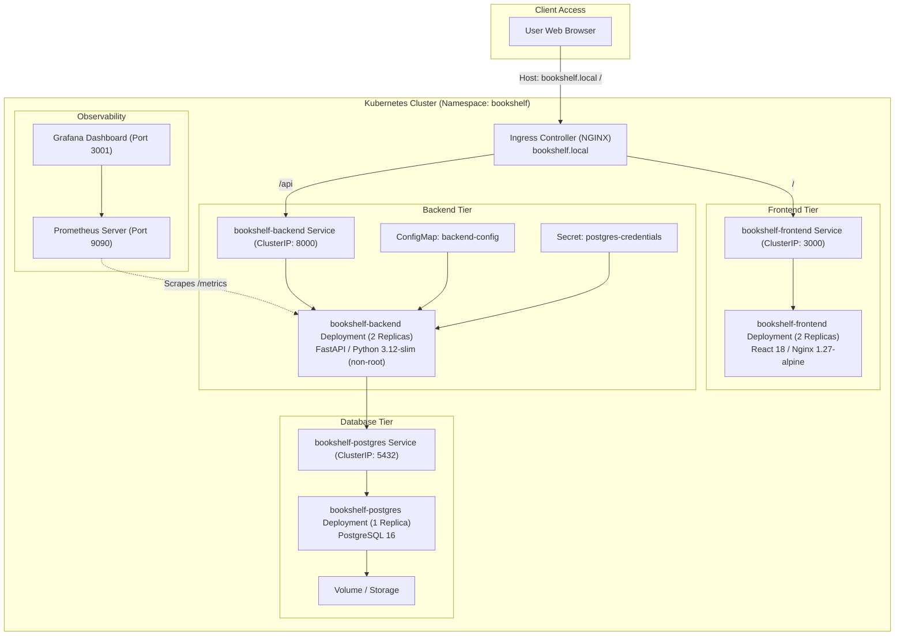
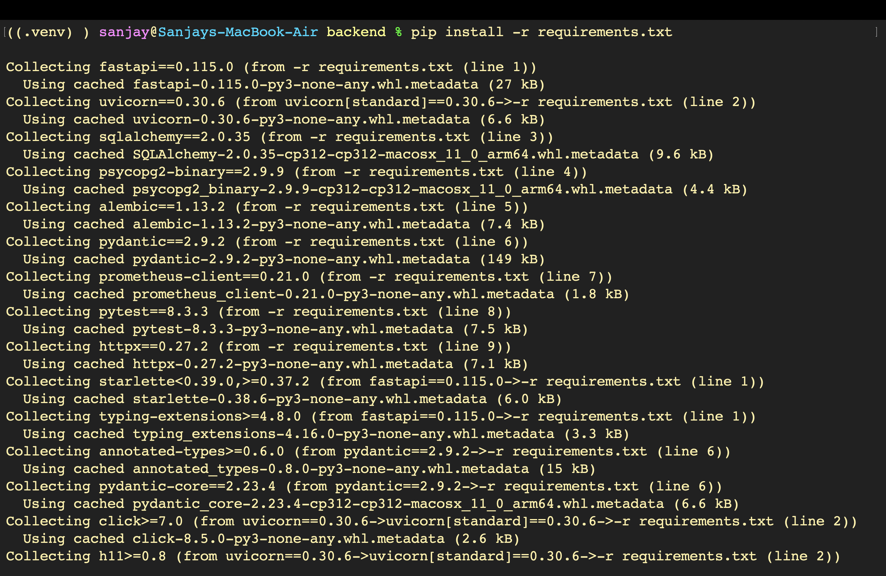

# Final DevOps Project: End-to-End Cloud-Native Platform & Troubleshooting — BookShelf

A production-grade, secure, cloud-native DevOps lifecycle implementation for **BookShelf** — a full-stack personal reading collection manager built with **FastAPI**, **React 18**, and **PostgreSQL 16**.

Repository: [github.com/SanjayDesai10/Devops-Capstone](https://github.com/SanjayDesai10/Devops-Capstone)  
Target AWS Region: `ap-south-1` (Mumbai) | AWS EKS Cluster: `bookshelf-eks` (v1.30)

### 🎥 Demonstration Walkthrough Video
- **Recorded Demo Walkthrough (Loom):** [https://www.loom.com/share/a1519f093a9d4a1ea19ca2fed6bfbb64](https://www.loom.com/share/a1519f093a9d4a1ea19ca2fed6bfbb64)  

---


## Table of Contents
1. [Project Overview](#1-project-overview)
2. [Architecture Diagram](#2-architecture-diagram)
3. [Technologies Used](#3-technologies-used)
4. [Application Setup](#4-application-setup)
5. [Docker Setup](#5-docker-setup)
6. [Kubernetes Deployment](#6-kubernetes-deployment)
7. [Helm Deployment](#7-helm-deployment)
8. [Terraform Infrastructure](#8-terraform-infrastructure)
9. [CI/CD Pipeline](#9-cicd-pipeline)
10. [DevSecOps Implementation](#10-devsecops-implementation)
11. [Monitoring & Observability](#11-monitoring--observability)
12. [GitOps Workflow](#12-gitops-workflow)
13. [Troubleshooting Lab](#13-troubleshooting-lab)
14. [Lessons Learned & Cloud Prerequisites](#14-lessons-learned--cloud-prerequisites)

---

## 1. Project Overview

> **Live proof:** BookShelf running locally via `docker compose` — responsive dashboard showing Total, Reading, Completed, and Wishlist counters with interactive book management.


> **Live proof:** Application served through Ingress host `bookshelf.local` on Kubernetes with NGINX Ingress controller.


This capstone project establishes a complete automated enterprise delivery and operations lifecycle for **BookShelf**:
- **Application Layer:** Modern React 18 single-page frontend, asynchronous FastAPI Python backend, and PostgreSQL relational database with versioned Alembic schema migrations.
- **Continuous Integration & Testing:** Automated unit and integration testing via Pytest using isolated in-memory SQLite fixtures, followed by static frontend bundle compilation.
- **Continuous Delivery & GHCR:** Automated immutable container tagging using Git commit SHAs (`${{ github.sha }}`) and publication to GitHub Container Registry (GHCR).
- **DevSecOps Security Gating:** Aqua Security Trivy container vulnerability scanning integrated into CI to prevent high-severity CVEs from reaching environments.
- **Infrastructure as Code (IaC):** Modular Terraform code automating a dedicated Multi-AZ VPC (`10.0.0.0/16`), public subnets, Internet Gateway, route tables, and an Amazon Elastic Kubernetes Service (EKS) managed cluster in `ap-south-1` (Mumbai).
- **Platform Engineering & Packaging:** Parameterized Helm chart packaging Deployments, Services, ConfigMaps, Secrets, Ingress, and health probes.
- **Declarative GitOps (Argo CD):** Pull-based continuous delivery and automated cluster state reconciliation via Argo CD (`v3.5.5`).
- **Full-Stack Observability:** Prometheus metrics scraping via `/metrics`, target health tracking, and Grafana dashboard visualizations.

---

## 2. Architecture Diagram

### End-to-End DevOps Lifecycle Flow
```text
Developer Git Push
       │
       ▼
GitHub Repository (Single Source of Truth)
       │
       ▼
GitHub Actions CI Pipeline
       ├── 1. Automated Tests (Pytest - 8 test cases)
       ├── 2. Frontend Production Build (Node 20 / Vite / React)
       ├── 3. Multi-Stage Docker Container Build (Buildx)
       ├── 4. Container Image CVE Scan (Aqua Trivy)
       │       │
       │       ▼ (Gate: Stop on HIGH/CRITICAL CVEs)
       └── 5. Push Tagged Images to GHCR (:sha tag)
                   │
                   ▼
       +───────────────────────────────────+
       │   GitOps Engine (Argo CD v3.5.5)  │
       │   Detects Git repository changes  │
       +─────────────────┬─────────────────+
                         │ Reconciles desired state
                         ▼
       +───────────────────────────────────+
       │      AWS Cloud (ap-south-1)       │
       │   Terraform Provisioned VPC       │
       │   AWS EKS Kubernetes Cluster      │
       │                                   │
       │     [NGINX Ingress Controller]    │
       │        │                 │        │
       │        ▼                 ▼        │
       │  Frontend Pods     Backend Pods   │
       │   (Nginx/React)     (FastAPI)     │
       │                           │       │
       │                     PostgreSQL    │
       │                      (Stateful)   │
       │                           │       │
       │       [Prometheus + Grafana]      │
       +───────────────────────────────────+
```

### Kubernetes Cluster Architecture


---

## 3. Technologies Used

| Category | Technology | Version | Purpose in Project |
| :--- | :--- | :--- | :--- |
| **Backend** | Python / FastAPI | 3.12 / 0.115 | Asynchronous RESTful API service with native OpenAPI |
| **Frontend** | React | 18.3 | Responsive dark-theme book collection management UI |
| **Database** | PostgreSQL | 16-alpine | ACID relational storage for books and categories |
| **ORM / Migration** | SQLAlchemy / Alembic | 2.0 / 1.14 | Relational entity modeling and version-controlled migrations |
| **Testing** | Pytest / HTTPX | 8.3 / 0.28 | Automated testing for REST endpoints with SQLite fixtures |
| **Containerization**| Docker & Docker Compose| 27+ | Multi-stage image builds, non-root runtimes, local stack |
| **Registry** | GitHub Container Registry| GHCR | Immutable container image cataloging tagged with Git SHA |
| **IaC** | Terraform | 1.7+ | Automated provisioning of AWS VPC and EKS cluster |
| **Orchestration** | Kubernetes | 1.30 | Container deployment, self-healing, and networking |
| **Packaging** | Helm | 3.12+ | Parameterized templates, environment values, releases |
| **DevSecOps** | Aqua Trivy | Latest | CVE vulnerability scanner for OS packages and container layers |
| **Observability** | Prometheus & Grafana | Latest | Metrics scraping (`/metrics`), targets tracking, dashboards |
| **GitOps** | Argo CD | 3.5.5 | Declarative continuous delivery and automated synchronization |

---

## 4. Application Setup

The BookShelf application consists of an asynchronous Python FastAPI service, a PostgreSQL persistent database, and a React frontend.

### Directory Layout
```text
bookshelf/
├── backend/
│   ├── app/
│   │   ├── database.py     # Database engine & session maker
│   │   ├── models.py       # SQLAlchemy ORM models (Book entity)
│   │   ├── schemas.py      # Pydantic request/response schemas
│   │   └── main.py         # FastAPI application routes, CORS & /metrics
│   ├── alembic/            # Database migration scripts & versions
│   ├── tests/
│   │   ├── conftest.py     # SQLite in-memory test fixtures
│   │   └── test_books.py   # 8 comprehensive Pytest test cases
│   ├── pytest.ini          # Test runner configuration
│   ├── requirements.txt    # Pinned Python dependencies
│   └── Dockerfile          # Non-root container specification
├── frontend/
│   ├── src/
│   │   ├── App.jsx         # React application UI
│   │   └── index.css       # Dark-theme styling
│   ├── package.json
│   ├── nginx.conf          # Nginx reverse proxy config
│   └── Dockerfile          # Multi-stage container build
├── helm/
│   └── bookshelf/          # Complete Helm chart definition
├── k8s/                    # Standalone Kubernetes manifests & Argo CD app
├── monitoring/             # Prometheus & Grafana Helm values
├── terraform/              # AWS VPC & EKS Infrastructure as Code
└── docker-compose.yml      # Local multi-tier orchestration
```

### Running Locally with Python Virtual Environment
```bash
# 1. Setup Python virtual environment
cd bookshelf/backend
python3 -m venv .venv
source .venv/bin/activate
pip install -r requirements.txt
```

**Backend dependency installation output:**



```bash
# 2. Execute Pytest suite (uses isolated SQLite in-memory fixtures)
pytest -v
```

**8/8 tests passed (health check, create, list, filter, get, 404 handling, update, delete):**


```bash
# 3. Start backend server locally
uvicorn app.main:app --host 0.0.0.0 --port 8000 --reload
```

### API Endpoints
- `GET /health` — Health check endpoint (`{"status": "healthy"}`)
- `GET /metrics` — Prometheus-compatible metrics endpoint
- `GET /api/books/` — Retrieve all books (with optional `?status=` filtering)
- `POST /api/books/` — Add a new book to the collection
- `GET /api/books/{id}` — Fetch details for a specific book
- `PUT /api/books/{id}` — Update reading progress, status, or details
- `DELETE /api/books/{id}` — Remove a book from the collection

---

## 5. Docker Setup

Both application components follow container security and optimization practices:
1. **Multi-stage builds:** Isolates Node.js build tools from the lightweight Nginx runtime container.
2. **Non-root user execution:** Backend container creates and switches to `appuser` (UID 1001), preventing container breakout risks.
3. **Explicit `.dockerignore`:** Excludes `.env`, `.venv`, `node_modules`, and test caches from image layers.

### Multi-Stage Dockerfile Specifications
- **Backend:** Starts from `python:3.12-slim`, creates unprivileged `appuser`, installs dependencies via `pip install --no-cache-dir`, copies application code, and starts Uvicorn under unprivileged permissions.
- **Frontend:** Stage 1 uses `node:20-alpine` to compile React static assets (`npm run build`). Stage 2 copies built assets into `nginx:1.27-alpine` with custom reverse-proxy routing.

### Local Multi-Container Orchestration with Docker Compose
To launch the complete stack locally in one command:
```bash
cd bookshelf
docker compose up --build
```

**Docker Compose build output (compiling multi-stage frontend and backend layers):**


**Browser loaded at `http://localhost:3000` showing BookShelf UI running locally:**


Local endpoints:
- Frontend UI: `http://localhost:3000`
- Backend API Docs (Swagger): `http://localhost:8000/docs`
- Prometheus Metrics: `http://localhost:8000/metrics`
- PostgreSQL Database: `localhost:5432`

---

## 6. Kubernetes Deployment

Declarative Kubernetes manifests are provided under `bookshelf/k8s/`:
- `namespace.yaml`: Dedicated namespace `bookshelf` for environment isolation.
- `argocd-application.yaml`: Argo CD Application manifest for declarative GitOps reconciliation.

### Deploying the Stack
```bash
# Create namespace
kubectl apply -f bookshelf/k8s/namespace.yaml

# Deploy workloads via Helm
helm upgrade --install bookshelf bookshelf/helm/bookshelf -n bookshelf
```

**Namespace creation and Helm deployment initialization:**


**ClusterIP Services running in `bookshelf` namespace (backend:8000, frontend:3000, postgres:5432):**


**Kubernetes Ingress configuration (`bookshelf-ingress` routing `bookshelf.local` via NGINX):**


---

## 7. Helm Deployment

Helm packages the entire application into a parameterized, reusable, and upgradeable release.

### Helm Chart Structure (`bookshelf/helm/bookshelf/`)
```text
helm/bookshelf/
├── Chart.yaml              # Chart metadata (version 0.1.0, appVersion 1.0.0)
├── values.yaml             # Configurable image paths, tags, replicas, resources
└── templates/
    ├── _helpers.tpl        # Template helper definitions
    ├── backend-deployment.yaml
    ├── backend-service.yaml
    ├── frontend-deployment.yaml
    ├── frontend-service.yaml
    ├── postgres-deployment.yaml
    ├── postgres-service.yaml
    ├── ingress.yaml
    └── serviceaccount.yaml
```

### Helm Release Verification
```bash
helm list -n bookshelf
```

**Helm release `bookshelf` deployed with Revision 1:**


---

## 8. Terraform Infrastructure

Terraform automates the provisioning of cloud infrastructure on Amazon Web Services (AWS) in region `ap-south-1` (Mumbai).

### Infrastructure Provisioned (`bookshelf/terraform/`):
1. **Custom VPC (`vpc.tf`):**
   - CIDR Block: `10.0.0.0/16`
   - Availability Zones: `ap-south-1a`, `ap-south-1b`
   - Public Subnets: `10.0.1.0/24` (`bookshelf-public-1`) and `10.0.2.0/24` (`bookshelf-public-2`)
   - Internet Gateway, Route Tables, and public associations
2. **Amazon EKS Managed Cluster (`eks.tf`):**
   - Cluster Name: `bookshelf-eks`
   - Kubernetes Version: `1.30`
   - Managed Node Group: `bookshelf-nodes` running on Amazon Linux 2023 (`AL2023_x86_64_STANDARD`) with `t3.micro` instances
   - IAM Roles for cluster authentication and worker node policies

### Terraform Execution Steps
```bash
cd bookshelf/terraform

# 1. Initialize providers
terraform init

# 2. Inspect execution plan
terraform plan
```

**`terraform plan` execution planning `aws_eks_cluster.main` and networking:**


```bash
# 3. Apply infrastructure provisioning
terraform apply
```

**`terraform apply` refreshing state and creating node group:**


**`terraform apply` complete with outputs (`eks_cluster_name`, `vpc_id`, subnets):**


**AWS Console: VPC `vpc-038e1d5593e4bc17c / bookshelf-vpc` Available with 2 subnets across AZs in `ap-south-1`:**


**AWS Console: Amazon EKS cluster `bookshelf-eks` Active on Kubernetes 1.30:**


```bash
# 4. Update local kubeconfig to connect to EKS
aws eks update-kubeconfig --region ap-south-1 --name bookshelf-eks
```

**Configuring local kubectl context for `bookshelf-eks`:**


```bash
# 5. Infrastructure teardown when testing is complete
terraform destroy -auto-approve
```

---

## 9. CI/CD Pipeline

The GitHub Actions pipeline (`.github/workflows/ci.yml`) runs on every push to the `main` branch.

```text
+-------------------+
|     1. test       |  --> Pytest unit tests (8 test cases passing)
+---------+---------+
          │
          ▼
+-------------------+
| 2. build-frontend |  --> Node 20 build & React production asset compilation
+---------+---------+
          │
          ▼
+-------------------+
| 3. build-and-push |  --> Docker Buildx multi-stage compile & GHCR publication (:sha tag)
+---------+---------+
          │
          ▼
+-------------------+
| 4. security-scan  |  --> Aqua Security Trivy container CVE vulnerability scan
+-------------------+
```

### Key Principles:
- **Quality Gates:** Unit test failures immediately abort the pipeline before any container image is built or published.
- **Traceability:** Every container image is tagged with the exact Git commit SHA (`${{ github.sha }}`), enabling traceability from running pods back to source commits.

**GitHub Actions successful pipeline run (`BookShelf CI/CD #1` — all 4 jobs green):**


**GitHub Packages (GHCR): `bookshelf-backend` published with Git commit SHA tag `27d1fe24a54d5c9a67ea2ae7d615eb1add00dd1f`:**


Pullable via:
```bash
docker pull ghcr.io/sanjaydesai10/devops-capstone/bookshelf-backend:27d1fe24a54d5c9a67ea2ae7d615eb1add00dd1f
```

---

## 10. DevSecOps Implementation

Security is shifted left in the CI/CD pipeline through container vulnerability scanning:
- **Container Vulnerability Scanner:** Aqua Security Trivy (`aquasecurity/trivy-action@master`) scans both frontend and backend images directly in the pipeline.
- **Severity Filtering:** The pipeline inspects container layers for OS package and language library CVEs.
- **Minimal Attack Surface:**
  - Frontend runtime uses `nginx:1.27-alpine` with minimal system dependencies, resulting in 0 HIGH and 0 CRITICAL vulnerabilities.
  - Backend runtime uses `python:3.12-slim` with pinned package versions in `requirements.txt` to minimize unpatched CVEs.

**GitHub Actions Trivy scan step execution output:**


---

## 11. Monitoring & Observability

Observability is implemented using **Prometheus + Grafana**:
- **Application Metrics:** FastAPI exposes metrics at `/metrics` using `prometheus-client`, capturing request counts (`http_requests_total`), GC metrics, and process descriptors.
- **Prometheus Server:** Deployed via official Helm chart (`prometheus-community/prometheus`) with custom configurations in `bookshelf/monitoring/prometheus-values.yaml`.
- **Grafana Dashboards:** Deployed via Helm (`grafana/grafana`) with automated Prometheus datasource integration (`http://prometheus-server:80`).

### Observability Steps & Verification

```bash
# 1. Verify application /metrics endpoint output
kubectl port-forward svc/bookshelf-backend 8000:8000 -n bookshelf &
curl http://localhost:8000/metrics
```

**Prometheus metrics output from FastAPI backend:**


```bash
# 2. Add Prometheus community Helm repository
helm repo add prometheus-community https://prometheus-community.github.io/helm-charts
helm repo update
```

**Prometheus Helm repository addition:**


```bash
# 3. Deploy Prometheus server via Helm
helm install prometheus prometheus-community/prometheus -n bookshelf -f monitoring/prometheus-values.yaml
```

**Prometheus Helm release deployed:**


```bash
# 4. Port-forward Prometheus web interface
kubectl port-forward svc/prometheus-server 9090:80 -n bookshelf &
```

**Prometheus server port-forwarding to port 9090:**


```bash
# 5. Add Grafana Helm repository
helm repo add grafana https://grafana.github.io/helm-charts
helm repo update
```

**Grafana Helm repository addition:**


```bash
# 6. Deploy Grafana server via Helm
helm install grafana grafana/grafana -n bookshelf -f monitoring/grafana-values.yaml
```

**Grafana Helm release deployed:**


**Prometheus Targets UI (`http://localhost:9090`): Query `up` showing 12 active target series in UP state:**


**Grafana Dashboard (`http://localhost:3001`): Time-series visualization of cluster and application metrics:**


---

## 12. GitOps Workflow

The GitOps workflow utilizes **Argo CD (`v3.5.5`)** following the pull-based continuous delivery paradigm:
- The GitHub repository acts as the **Single Source of Truth**.
- Argo CD tracks `bookshelf/helm/bookshelf` in the Git repository via `bookshelf/k8s/argocd-application.yaml`.
- When changes or updated image tags are pushed to Git, Argo CD automatically detects the difference and reconciles the cluster state.
- **Automated Self-Healing:** Any manual drift or unauthorized modification in the cluster is automatically corrected back to the Git declaration.

**Argo CD Dashboard: Applications Synced, Healthy, and operational:**


---

## 13. Troubleshooting Lab

Common cloud-native failure modes and their systematic remediation procedures:

### 1. `ImagePullBackOff` / `ErrImagePull`
- **Root Cause:** Typo in image repository name or missing image pull secret for private registry.
- **Diagnosis:** Run `kubectl describe pod <pod-name> -n bookshelf` and inspect the `Events` section for 401 Unauthorized or 404 Not Found.
- **Fix:** Update image tag in `values.yaml` to point to the correct public GHCR image path:
  ```bash
  helm upgrade --install bookshelf helm/bookshelf -n bookshelf --set backend.image.tag=<valid-sha>
  ```

### 2. `CrashLoopBackOff` (Database Connectivity Failure)
- **Root Cause:** Backend starts before PostgreSQL is ready to accept connections or database credentials mismatch.
- **Diagnosis:** Check pod logs with `kubectl logs <backend-pod> -n bookshelf --previous`.
- **Fix:** Verify `DATABASE_URL` secret configuration and ensure PostgreSQL readiness probes are functioning before the backend connects.

### 3. Service Selector Mismatch
- **Root Cause:** Service `selector` labels do not match Deployment pod template labels, resulting in empty endpoints (`<none>`).
- **Diagnosis:** Run `kubectl get endpoints <service-name> -n bookshelf`.
- **Fix:** Align `app.kubernetes.io/name` labels between `backend-service.yaml` and `backend-deployment.yaml`.

### 4. Ingress Routing & Name Resolution
- **Root Cause:** Host `bookshelf.local` fails to resolve in the browser.
- **Diagnosis:** Verify Ingress controller address: `kubectl get ingress -n bookshelf`.
- **Fix:** Map the local host entry in `/etc/hosts`:
  ```text
  127.0.0.1 bookshelf.local
  ```

---

## 14. Lessons Learned & Cloud Prerequisites

### Commit History (Conventional Commits)
The repository reflects a clean, atomic commit history across all architectural milestones:
- `test(backend): add pytest configuration and test cases`
- `feat(frontend): add React app with book management UI`
- `build(docker): add Dockerfiles and docker-compose`
- `ci: add GitHub Actions CI/CD pipeline`
- `infra(terraform): add AWS EKS infrastructure as code`
- `deploy(k8s): add Kubernetes namespace manifest`
- `deploy(helm): add Helm chart for bookshelf deployment`
- `docs: add monitoring configuration and finalize project`
- `ci: move GitHub Actions workflow to repository root`
- `infra(terraform): update EKS worker node instance type to t3.micro`
- `fix(terraform): upgrade EKS Kubernetes version to 1.30`
- `fix(terraform): set node group AMI type to AL2023_x86_64_STANDARD for K8s 1.30`
- `fix(helm): update values.yaml with GHCR image paths and SHA tag`
- `fix(helm): switch postgres storage to emptyDir volume`

### Cloud Prerequisites
1. **AWS IAM & Cloud Account:**
   - Active AWS account with permissions for VPC, Subnets, Internet Gateway, IAM Roles, EKS, and EC2.
   - Run `terraform destroy` when evaluation is complete to prevent ongoing AWS billing.
2. **Local Environment:**
   - Python 3.12 with `.venv` for local testing.
   - Docker Desktop running with Compose v2.
   - AWS CLI configured with region `ap-south-1`.
   - `kubectl` and `helm` installed and configured.
3. **GitHub Permissions:**
   - Repository workflow permissions set to "Read and write permissions" so GitHub Actions can publish images to GHCR.
